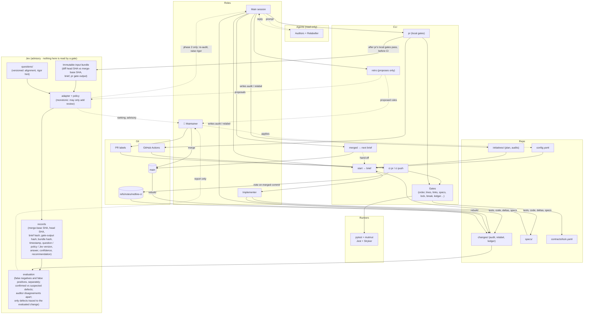

# Jev in Redline: plan

Written 2026-10-21, against `main` after PR #39 (build 9 part 2), as jev-plan.md; tracked here
from 2026-10-24. Not started. This file is the agreed design from one discussion; a session that
takes it up turns it into an initiative (below) and doesn't need that discussion's history.

Jev is an external decision service that answers narrow, typed questions (a choice, a score, a
probability). Nothing in this repository uses it yet, and its API isn't settled here: the adapter
(below) is the only code that knows it.

## The question this answers

> Does Jev find the PRs that merit more scrutiny, with false negatives acceptably low, without
> adding too much review cost?

That is the initiative's goal. Jev is an experiment to be measured, not a correctness mechanism.
Agreement with an auditor doesn't prove either one right.

## When

After the review's item 19 (per-scenario outcomes, build 11 in plan.md), before or alongside
build 8. The review's items ([review-2026-10-20.md](review-2026-10-20.md)) repair
the gates, the ledger and the outcome records that Jev's evaluation is scored against; scoring it
against records known to be wrong would teach little. Step 8 (JUnit/PIT, Jest reach) has nothing
Jev depends on.

## How it enters Redline

The repository's own rules, as for every change:

1. Design text first: this file is Jev's section, plan.md lists it as build 12, after build 11,
   and each open item gets an O-ID in [12-open-problems.md](12-open-problems.md) (`O-JEV1`, …).
2. An initiative, `redline/initiatives/jev/plan.md` (draft at the end of this file), with one
   change per piece below, each following S → red → green in PRs of at most 400 lines.

## Rules Jev never breaks

These are the design. Any part that would break one is out, however useful it looks.

1. **Nothing a gate reads.** No gate, `ci pr`, `ci push`, `check-plan` or `start` reads Jev's
   records, answers or reports. Jev's files live where no gate looks (Records, below).
2. **Monotonic.** Jev's output can only add review: re-run the auditor, consider a higher
   `Rigor:`. It never removes a step, closes or waives a finding, lowers a level, or lets anything
   pass that would otherwise fail.
3. **Not in CI.** No call to Jev in `ci pr` or `ci push`. CI stays reproducible, reading
   everything at the merge-base, with no network dependency and no Jev secret in Actions.
4. **No labels, no audit files, no merges.** Labels feed CI, so Jev doesn't apply them. It doesn't
   write `audit.md`, `relabel.yaml`, the ledger or anything in `changes/` or `initiatives/`.
   Only the maintainer merges.
5. **Confidence is never a threshold for skipping.** It is recorded and scored. Low confidence
   means "uncertain, worth a look", not "defect"; high confidence never bypasses anything.
6. **No deterministic facts.** Line counts, spec files, links, order, locks and test exit codes
   come from code. Jev is never asked them.
7. **The evaluation reports to the maintainer only.** Nothing in it changes Jev's policy, its
   questions or any gate. Thresholds change only when the maintainer changes them, as with
   `retro` rules.

## Architecture

Redline as it is, plus the `Jev` subgraph and the edges under `%% Jev`.



Phase 1 is this diagram without the `phase 2 only` edge.

## The pieces

### Input bundle

Built by `redline pr` once its local gates pass: the deterministic checks, not the CI suite, so
Jev runs while its advice can still change what happens to the PR. A failing `pr` never calls Jev.

The bundle is immutable and fully specified: the diff from the merge-base SHA to the head SHA, the
step's brief, and `pr`'s gate output. The bundle hash covers exactly the bytes Jev was sent.

### Questions

Versioned files, one per question, each with a fixed answer type:

| Question | Answer | Asked |
|---|---|---|
| Is this PR aligned with its brief? | aligned / partial / misaligned, with confidence | every step PR |
| Is the declared level too low? | no / maybe / yes, with confidence | S steps (where `Rigor:` is declared) |
| Rank these `retro` proposals | an ordering | when `retro` runs |

Not asked, and why:

- **Which agent runs next**: `start` and `ci pr` already decide it from `steps.md` at the
  merge-base (build 9 part 1). A second answer could only disagree.
- **Triage of audit findings** (block / review / note): a finding is closed only by re-running
  its auditor (§4). Jev downgrading one would be a non-independent party closing it.
- **Whether a test failure is noise**: a failing gate is a fact; rerunning until it passes is the
  weakening the gates exist to stop.

### Adapter and policy

The adapter is the only code that knows Jev's API. It sends the bundle and question, and returns
a typed answer or an error. Timeouts and retries are bounded.

The policy maps an answer to a recommendation and is monotonic:

| Answer | Recommendation |
|---|---|
| alignment `partial` or `misaligned`, or low confidence | re-run the auditor on this step |
| level `maybe` or `yes` | consider a higher `Rigor:` |
| anything else | none |
| Jev unavailable, timed out, malformed | none; recorded as an error |

An unavailable Jev gives no recommendation and blocks nothing. Failing closed would turn Jev into a
gate, which rule 1 forbids; the error is recorded so the evaluation sees the gaps.

Acting on a recommendation goes through the normal paths: the main session re-runs the auditor,
the maintainer edits the proposal's `Rigor:` (raising it is never a claim, §8).

### Records

One record per question asked, holding: merge-base SHA, head SHA, brief hash, gate-output hash,
bundle hash, timestamp, question version, policy version, Jev and runtime version, answer,
confidence (if Jev gives one) and recommendation.

Stored as git notes on the head SHA under `refs/notes/redline-jev`, the way CI results live in
`refs/notes/redline-ci`. They're outside the tree, so they don't count toward a PR's 400 lines and
no gate reads them (rule 1). The session pushes the notes ref itself; no CI token needs to write it.

### Evaluation

`redline jev report` reads the records and the outcomes Redline already records, and reports to
the maintainer. Scored separately:

- **False negative**: Jev recommended nothing, and the evaluated change had a **confirmed** problem:
  an auditor finding on that step that wasn't closed as wrong, or a ledger defect traced to that
  change.
- **False positive**: Jev recommended a re-audit or higher level, and the re-audit found nothing
  and no defect was later traced to the change.
- **Kept apart**: suspected defects that weren't confirmed, and auditor disagreements (an auditor
  re-run that changed its own answer, or relabel disagreeing with the first label). These show
  uncertainty, not a miss by Jev.
- Only defects traced to the evaluated change count against it. A defect that surfaces later in
  another change isn't Jev's miss on this one.
- Also reported: escalation rate, Jev errors, latency, cost per PR.

Agreement alone isn't reported as a score: most PRs are fine, so a Jev that never flags anything
would agree most of the time.

## Phases

**Phase 1, shadow.** Jev answers and records; nothing in the workflow changes and no one sees its
recommendations during a step. The evaluation builds a baseline.

Before phase 1 starts, the maintainer writes down what phase 2 needs: the minimum number of
evaluated PRs, the highest acceptable false-negative rate, the highest acceptable escalation rate.
Fixing these before seeing the data stops the bar moving to fit the result.

**Phase 2, advice.** Only if phase 1 meets those numbers. Recommendations reach the main session
(the `phase 2 only` edge) and `retro` proposals get Jev's ranking. Evaluation continues; the
maintainer can turn advice off again.

There is no phase 3. Anything that would let Jev reduce scrutiny or decide something on its own
breaks rules 1 and 2.

## Draft plan

`redline/initiatives/jev/plan.md`, to be written when the initiative starts:

```markdown
# Initiative: jev
Goal: measure whether Jev finds the PRs that merit more scrutiny, with few false negatives and little added review cost

## Phase 1: Shadow
Changes: jev-records, jev-adapter, jev-report
Stop: every step PR's pr run records Jev's answers as notes, and redline jev report scores them against audits, relabels and the ledger; no workflow behaviour changed

## Phase 2: Advice
Changes: jev-advice, jev-retro-rank
Stop: recommendations reach the main session after pr, retro proposals carry Jev's ranking, and nothing Jev outputs is read by a gate
```

| Change | What | Rough PRs |
|---|---|---|
| jev-records | Input bundle from `pr`, record format, notes ref | 2 |
| jev-adapter | Adapter, questions, monotonic policy, error handling; tests for every policy row and for unavailable or malformed answers | 2–3 |
| jev-report | `redline jev report`: false negatives, false positives, buckets kept apart | 2 |
| jev-advice | Recommendations shown after `pr` | 1 |
| jev-retro-rank | Ranking on `retro` proposals | 1 |

About 8–9 PRs, plus the design-text PR. Phase 2's changes start only after the maintainer has
checked phase 1's numbers against the bar written down beforehand.

A test in jev-records or jev-adapter should pin rule 1: no gate's code path imports the Jev
modules or reads `refs/notes/redline-jev`.

## Open questions

- **Jev itself**: its API, what a call costs, how fast it answers. Settled before jev-adapter.
- **Rigor**: `standard` seems enough, since Jev adds no enforcement and CI doesn't call it.
  `critical` would add plan audits at each phase. Raising the level later is never a claim.
- **The secret**: where the session's Jev credentials live. They must never be in the repository
  or in Actions.
- **Phase 2's numbers**: the bar described under Phases, set by the maintainer.
